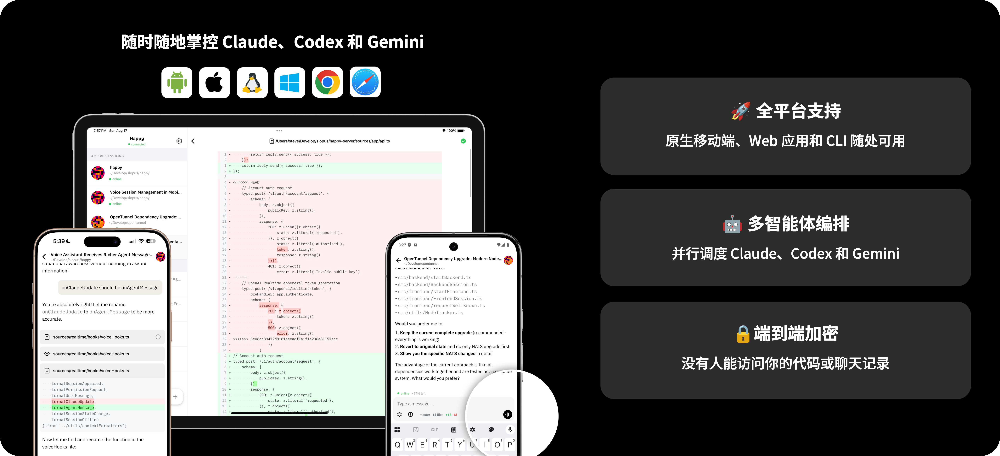

<div align="center"></div>

<h1 align="center">
  Claude Code、Codex、Gemini 和 Qoder 的移动端和 Web 客户端
</h1>

<h4 align="center">
随时随地使用 Claude Code、Codex、Gemini 或 Qoder，端到端加密。
</h4>

<div align="center">

[🖥️ **Web 应用**](https://app.happy-next.com/) • [📱 **App Store**](https://apps.apple.com/us/app/happy-next/id6758196715) • [📦 **APK 下载**](https://github.com/hitosea/happy-next/releases/latest) • [📚 **文档**](docs/README.md) • [🇬🇧 **English**](README.md)

</div>



<h3 align="center">
第一步：下载应用
</h3>

<div align="center">
<a href="https://apps.apple.com/us/app/happy-next/id6758196715"></a>
&nbsp;&nbsp;
<a href="https://github.com/hitosea/happy-next/releases/latest"></a>
</div>

<p align="center"><sub><strong>地区可用性：</strong>iOS 版暂未在中国大陆 App Store 上架。中国大陆用户可以使用 <a href="https://app.happy-next.com/">Web 应用</a>。</sub></p>

<h3 align="center">
第二步：在你的电脑上安装 CLI
</h3>

```bash
npm i -g happy-next-cli
```

<h3 align="center">
第三步：用 `happy` 代替 `claude`、`codex`、`gemini` 或 `qodercli`
</h3>

```bash
# 原来用: claude
# 现在用: happy

happy

# 原来用: codex
# 现在用: happy codex

happy codex

# 原来用: gemini
# 现在用: happy gemini

happy gemini

# 原来用: qodercli
# 现在用: happy qoder

happy qoder
```

运行 `happy` 会打印一个二维码用于设备配对。

- 用第一步下载的应用扫描二维码（或在浏览器中打开 [app.happy-next.com](https://app.happy-next.com/)）。
- 前提：安装你想要控制的供应商 CLI（`claude`、`codex`、`gemini` 和/或 `qodercli`）。

<div align="center"></div>

## 🔥 为什么选择 Happy Next？

- 🎛️ **Claude、Codex、Gemini 和 Qoder 的远程控制** — 四个 Agent 均为一等公民
- 🤖 **编排器** — 定义多 Agent 任务 DAG、自动调度执行，并查看关联的运行历史
- ⚡ **即时设备切换** — 一键夺回控制权
- 🔔 **推送通知** — 随时知道你的 Agent 需要关注，并可直接在通知上处理权限请求
- ⌚ **Apple Watch** — 在手腕上查看会话和消息并回复，表盘复杂功能显示需要你处理的会话数
- 🔐 **端到端加密 + 可自托管** — 默认加密，一条命令 Docker 部署
- 🎙️ **语音助手** — 火山引擎（豆包）实时网关，流式语音、iOS 原生语音通话、可选音色 / 语速
- 🧰 **多仓库工作区** — 基于工作树的多仓库工作流，支持分支选择和 PR 创建
- 📁 **代码浏览器和 Git 管理** — 从手机浏览文件、查看 diff、暂存/提交/丢弃
- 📋 **DooTask 集成** — 任务管理，实时聊天，一键 AI 会话
- 📨 **待发消息队列** — CLI 繁忙时消息排队，就绪后自动分发
- 📱 **原生移动体验** — iOS / Android 平台原生底栏与 header，iPad 窗口化模式适配
- 🖥️ **桌面客户端** — 原生体验的 macOS 和 Windows 客户端，支持托盘、通知、快捷键和签名自动更新

## 工作原理

在电脑上运行 `happy` 代替 `claude`，`happy codex` 代替 `codex`，`happy gemini` 代替 `gemini`，或 `happy qoder` 代替 `qodercli`，通过我们的包装器启动你的 AI。当你想从手机上控制编码 Agent 时，它会以远程模式重启会话。要切换回电脑，只需按键盘上的任意键。

## Happy Next 新特性

Happy Next 是原版 Happy 的重大演进，以下是亮点：

### 桌面客户端（macOS + Windows）
- 提供 macOS 12+ Universal、Windows x64 和 Windows ARM64 直接下载版本
- 点击 macOS 侧栏标题返回会话首页
- 登录状态自适应窗口尺寸与原生状态恢复、交通灯位置稳定且侧栏 header 更协调的 macOS 无边框标题栏、Logo 可返回会话首页的集成式 Windows 标题栏、优化的全屏/标题栏交互、多显示器边界保护，以及带原生启动 Logo 的主题无闪烁启动
- 托盘常驻、关闭到托盘、单实例激活、带一致应用图标且可可靠恢复应用并打开对应会话的纯文本系统通知，以及统一的程序坞/任务栏未读提示
- 原生应用菜单、搜索与导航快捷键、可选开机启动和全局显示/隐藏快捷键
- 签名更新包会定期以及在应用重新获得焦点时检查，在后台静默下载，并由用户点击更新按钮后安装并重启
- 桌面诊断、轮转本地日志、WebKit 存储维护、上传失败恢复、麦克风/摄像头支持、原生上下文菜单、可靠且主题隔离的 HTML 预览窗口、兼容 CSP 的代码编辑、系统浏览器外链和受限原生权限

- 终端在独立的桌面窗口中打开，带自己的标签栏，标题显示 shell 所在目录
- 本机上的终端直接经本地 daemon 连接而不走服务端，输入即时响应，服务端断开时已打开的终端照常可用；连不上 daemon 时退回服务端，直连的终端在标签提示中标注"(direct)"
- macOS 标题栏改为紧凑的工具栏

### Apple Watch
- 在 iPhone 或手表的权限通知上直接允许、本会话内允许、拒绝、停止或回复
- 手表 App 按 App 中的顺序列出会话并显示头像，置顶会话在前；打开会话显示最新消息，轻点即可加载更早的消息，可用听写或快捷回复回复；停止任务前会先确认
- 表盘复杂功能显示等待批准和正在工作的会话数

### 编排器（Orchestrator）
- 定义任务依赖图（DAG），支持按任务指定模型和工作目录
- 跨 Claude、Codex、Gemini 和 Qoder 自动调度执行
- 实时状态徽章、活动计数（含排队任务，而不仅是运行中的任务）和状态颜色进度条
- 清晰的任务执行历史、更顺畅的运行导航，以及从编排器消息直达对应运行的链接
- 通过会话恢复跟进已完成任务
- MCP 工具集成，自动填充工作目录
- Happy CLI 启动时自动安装编排器 skill 和 `/orchestrator` 斜杠命令——直接在 CLI 里把任务并行或按依赖分发给 Claude / Codex / Gemini / Qoder agent
- 内置 `/preview-html` 斜杠命令——在 CLI 里生成自包含 HTML 文档并直接在 app 内预览
- 编排运行和任务显示耗时，运行筛选简化为全部、进行中、已完成、失败、已取消；任务结果只保留 agent 的最终回复，运行中可实时跟进
- 恢复的任务会回报给发送跟进消息的会话，该运行在两个会话中都会列出
- `orchestrator_exec` 可在单台或所有在线机器上执行 shell 命令，长输出保存在机器上
- 编排任务端到端加密——服务端看不到任务的标题、提示词、命令、工作目录和目标机器——并且只会派给 CLI 能解开它的机器
- `orchestrator_transfer` 可在机器之间复制文件和目录，全程端到端加密传输
- 可按标题搜索运行记录，并按状态、Agent 和机器筛选，每条运行记录显示其 Agent 图标
- 编排器页面的文字可在 Web 和桌面端选择、复制
- 从会话打开时，运行筛选只列出这个会话的运行用过的机器和执行器类型

### 待发消息队列
- CLI 繁忙时消息在服务端排队，就绪后自动分发
- 队列面板 UI，支持图片数量徽章和立即发送
- 排队消息可在发送前编辑，也可暂停或保存为草稿而不分发
- 重连同步和并发分发安全，回合结束后立即发出下一条排队消息
- 排队消息可以「插话」进正在运行的回合而不打断它（Claude、Codex 和 Qoder），与「立即发送（打断）」并列；队列是输入框上方的浮动卡片堆，每条消息有自己的菜单
- 从输入框的添加菜单定时发送消息——30 分钟后、1 小时后、用量限制重置后，或自选时间

### 多 Agent 支持（Claude Code + Codex + Gemini + Qoder）
- 四个 Agent 均为一等公民，支持会话恢复、复制/分叉和历史记录
- 多 Agent 历史页面，按供应商分标签页，支持设备和 Agent 类型筛选
- 按 Agent 选择模型、费用追踪和上下文窗口显示
- Codex 支持 ACP 和 App-Server（JSON-RPC）两种后端，内置 Codex v0.155.1 并支持 fast mode
- Codex 归档操作同步到原生历史，保持归档状态显示一致，并可在继续工作时恢复已归档会话
- 更可靠的 Codex 会话复制和分叉，并明确提示活动会话冲突
- Codex 交互式问题和审批请求可直接在应用中处理，支持选项、自定义“其他”、自由文本和敏感回答掩码
- 新增 Claude Opus 4.8 支持，过滤 4.x 模型的空 thinking 块以保证渲染干净
- 模型目录支持 Claude Fable 5.1 和 Fable 5，提供 1M 上下文及 low / medium / high / xhigh / max 五档推理强度
- 新增 Claude Opus 5 和 Claude Sonnet 5，支持 1M 上下文、当前推理强度预设、快速模式能力识别和更新后的费用追踪
- 精简模型选择器：每个 Claude 模型只有一项并使用完整上下文窗口，宽屏下推理强度并排显示，Claude 默认 High 强度；上下文条按 Claude Code 实际使用的窗口计算
- 创建会话或在模型设置中选择 Claude 或 Qoder 会话运行的上下文窗口——200K、1M 或自定义大小；模型列表新增 Claude Fable 5.2
- 模型目录支持 GPT-6 Astra，并更新 GPT-5.6 Sol、Terra、Luna 的推理强度和上下文配置
- 刷新 Gemini 模型目录，加入 Gemini 3.8 Flash，并保留现有 Gemini 模型
- 通过 ACP 接入 Qoder CLI，支持账号模型与推理强度、权限模式与 plan 模式，Qoder 和 Gemini 会话显示上下文用量
- 对 shell 命令选择“不再询问”时可选择覆盖哪些程序或子命令，四个 Agent 均支持
- 模型目录由服务端下发，新模型无需更新 App 即可出现——现已加入 Claude Opus 5.5、Claude Sonnet 5.5、GPT-6.1-Sol、GPT-6-Sol 和 GPT-6-Luna
- 设置弹层为每种权限模式和 AI 厂商附上说明，模型描述跟随 App 语言，包括简体中文和繁体中文
- Codex 的“帮我批准”模式把审批交给 Codex 自己的审查代理；会执行操作的编排工具（运行命令、发送消息、传输文件、取消任务）在所有 Agent 下都会先请求权限
- Codex 会在账号配额用完前预警，并不再丢弃生成图片、完成的 plan、hook 运行和审批决定；Codex 自己的标题、`/model` 切换、警告、`/review` 标记和 sleep 也会显示在会话里
- Qoder 的 plan 显示为 TodoWrite 步骤

### 语音助手（Happy Voice）
- 语音网关认证改用短效 token，安全性提升
- 火山引擎（豆包）实时网关，统一驱动语音识别、LLM 与语音合成，替代此前的 LiveKit / ElevenLabs 方案
- iOS 原生通话内语音，支持流式语音合成；连接态基于房间状态变化收敛，通话中麦克风受保护
- 可选音色与语速；多语言回复默认使用 seed-tts-2.0 音色
- 语音合成前更智能的 LLM 文本清洗——简单短文本跳过清洗以降低延迟，通话内播报本地化
- 语音助手配置经端到端加密的用户设置跨设备同步
- 麦克风静音、语音消息发送确认、"思考中"指示器
- 上下文感知语音：应用状态自动注入到语音 LLM
- 在消息底部一键朗读任意 AI 回复——真流式合成边生成边播放,配合全局朗读队列与可拖拽悬浮播放器,可排队多条消息并在任意界面控制播放;v2 清洗提示词带 digest 模式,长消息会被凝练以获得更顺畅的朗读
- 语音管理会话——通过专用语音工具启动、切换、向会话发送消息，会话设置收敛为单一 mode 参数，标题更清晰，会话选择器取消按钮带自动关闭倒计时

### GitHub 集成
- 浏览已连接的仓库，并在应用中直接跳转到 GitHub 关联内容
- 连接 GitHub 账号，浏览仓库、Issue 和 PR
- 在应用中创建、评论、关闭和重新打开 Issue 与 PR
- 携带 Issue 或 PR 上下文启动 AI 会话，并从详情页返回关联会话
- GitHub 列表改用 Octicons 图标，仓库列表本地缓存，返回时即时呈现
- 列表总数本地缓存，刷新时显示加载指示；Issue 和 Pull Request 评论新增"滚到底部"按钮

### 多仓库工作树工作区
- 从应用中创建、切换和归档多仓库工作区
- 按仓库选择分支、设置和脚本
- 跨仓库聚合 git 状态
- 自动生成工作区 `CLAUDE.md` / `AGENTS.md`（含 `@import` 引用）
- 工作树合并和 PR 创建，支持目标分支选择
- AI 驱动的 PR 代码审查，结果发布为 GitHub 评论

### 代码浏览器和 Git 管理
- 安全预览图片和支持的文件，支持下载最大 100 MiB 的文件
- 完整的文件浏览器，支持搜索、Monaco 编辑器查看/编辑
- 提交历史，支持分支选择器（本地 + 远程）
- Git 变更页面：暂存、取消暂存、提交、丢弃
- 按文件差异统计（+N/-N），支持 Claude、Codex 和 Gemini
- 图片预览，支持分享
- 提交列表标记上游分支 tip 所在的 commit
- 可直接从导航栏复制当前浏览器面包屑路径
- 批量 Git 操作执行期间显示加载反馈
- 从 git 状态打开文件页时自动聚焦相关变更文件
- 文件夹选择器进出文件夹时不再跳动，返回上一级改为 home 旁的返回按钮
- 文件列表里的长路径从中间省略，开头和结尾都能看清

### 会话共享
- 直接邀请好友或通过公开链接分享会话
- 端到端加密：直接分享使用 NaCl Box，公开链接使用 token 派生密钥
- 实时同步消息、git 状态和语音聊天
- 按访问级别（查看/编辑/管理）控制权限
- 会话列表"全部/共享给我/我分享的"过滤标签和共享指示器
- 公开分享网页查看器，无需安装应用即可访问，消息分页加载，长共享会话打开更快
- 共享会话的接收者可以上传聊天图片，发送失败时会说明真实原因

### DooTask 集成
- 任务列表，支持过滤、搜索、分页和状态工作流
- 任务详情，支持 HTML 渲染、负责人、文件、子任务
- 实时 WebSocket 聊天（Slack 风格布局、表情回应、语音回放、图片/视频）
- 从任一任务一键启动 AI 会话（MCP 服务透传）
- 在应用内直接创建任务和项目，跨平台日期选择器
- 全局化 WebSocket 连接，实时任务更新，持久化服务端连接
- DooTask 最近会话合并进收件箱，持久化缓存 + 后台静默刷新
- DooTask 关联会话显示头像，chat header 按对话类型自适应
- 空白聊天状态始终保持居中显示
- DooTask 设备会识别为 Happy Next，连接登录流程更简单，并支持跨设备同步连接
- 任务列表按筛选条件缓存，并在后台静默刷新
- 点聊天中任意图片即可浏览该聊天的所有图片；消息支持选择复制，复制长消息时取全文
- 一对一聊天的详情显示对方的个人卡片——头像、在线状态、职位、部门和邮箱

### 自托管
- 一条命令 `docker-compose up`（Web + API + Voice + Postgres + Redis + MinIO）
- 桌面端设置页新增自定义服务器快捷按钮，方便快速配置服务器
- 支持 API 和语音配置端点的服务发现
- 未配置自定义/自托管服务器时，会在官方默认 API 配置端点间竞速，选择最快可用入口
- 独立源架构（无路径反向代理）
- `.env.example` 包含完整配置参考
- Docker 构建的运行时环境变量注入
- 零成本 nginx `/healthz` 端点，用于负载均衡器/在线检测探针
- 服务端镜像在容器启动时自动执行数据库迁移（设置 `SKIP_DB_MIGRATIONS=true` 可关闭）

### 同步和可靠性
- v3 消息 API，基于 seq 的同步、批量写入和游标分页
- WebSocket 不可用时的 HTTP 发件箱可靠投递
- 服务端确认消息发送，支持重试和消息接收追踪
- 修复游标跳过、发件箱竞争、消息重复/丢失
- 聊天 reducer 不再合成乱序的 completed-permission 消息
- 弱网下消息发送加固；发送进行中时抑制草稿恢复
- 会话加载可靠性：消息抓取超时提升到 60s，从永久加载失败中自动恢复，刷新指示器在整个重试循环里保持显示，超大消息载荷的 base64 编码改为分块以避免栈溢出
- 本地持久化消息缓存让重新打开会话时更快显示已有历史
- 会话草稿重写为单一数据源 — 草稿消失/重现的情况减少
- App 在两次商店版本之间从 Happy 服务器获取更新，启动时和每次回到前台时检查；下载好后，无论在哪个页面，收件箱都会提示重启到新版本

### 聊天和会话体验
- 新建或现有会话支持图片附件、剪贴板粘贴（Web）和桌面拖放，Web 端也可拖放或粘贴任意其他文件，草稿支持图片；上传最大尺寸提升到 1568px 并跳过冗余压缩，保留代码截图和 UI 截图的文字清晰度，多图预览时保持当前选中图片
- 新会话标题以第一条用户消息播种（AI 摘要生成后再接管），不再使用目录名兜底
- 即使 Agent 没有 assistant 消息（如未知斜杠命令），CLI 的 result 文本也会呈现到手机端，不再出现空白回复
- 斜杠命令自动补全显示每个命令的来源 scope（仓库 / 用户 / 插件 / 系统）与类型；选择根命令后，建议只保留匹配的子命令，不再为自由文本参数混入 skill；会话能力独立于 metadata 存储并实时同步，命令与技能列表始终保持最新
- `/duplicate` 命令从任意消息分叉会话，包括直接从 AI 回复分叉，并更可靠地解析对应的用户消息目标
- 发送后立即显示乐观的"Processing…"状态，消息列表重载时显示"refreshing"指示器
- 消息分页、未读蓝点指示器、紧凑列表视图
- 对话缩略图导航面板——点击可快速跳转到长对话的任意位置，从离线消息缓存填充，消息未加载完或离线时也能看到导航概览
- 优化 minimap 覆层位置，让长对话导航更顺手
- Web 对话列表重写为模型驱动的虚拟化列表——跳转到某条消息时即时居中（已在目标处则给出轻微抖动反馈），历史随滚动按需加载；滚动经过稳定化处理,手势中不再跳动、滚动到底部精确落到真实底部,并用代理滚动条替换被扭曲的原生滚动条以呈现诚实的滚动位置
- 上下文用量提示框——在上下文指示器上展示 token 用量明细
- Web 侧边栏可调宽度——拖拽边缘调整侧边栏宽度
- 新建会话时自动选择最佳可用机器
- 按机器分会话标签页（会话按其运行所在的机器分组），每个标签页带稳定的状态圆点——该机器上有会话需要授权时显示橙色，并反映实时 thinking 状态，而聚合的「全部」标签页不显示圆点；会话预览展开/折叠、元数据缓存
- 可折叠项目文件夹将相关会话分组，并在本地保留文件夹状态
- 存在共享会话时仍显示机器标签页，「我分享的」列表会在分享状态变化后刷新
- 最近会话历史分页，加快首屏加载
- 会话重命名并锁定（防止 AI 自动更新）、历史搜索
- 会话详情提供常用会话任务的快捷操作
- 可从会话菜单设置或清除七种会话颜色标记，在各会话列表中快速直观地分类
- 选项点击发送 / 长按填充、滚动到底部按钮
- "始终显示上下文大小"默认开启，无需进入会话详情即可看到用量
- 逐条消息 action bar：复制、从此处分叉（带进度转圈）、朗读、以及完整时间戳（Web 悬浮 / 原生点按显示）
- Web 桌面端：消息悬浮显示复制按钮、右键 option 复用移动端长按行为
- 移动端文本选择：选择页改用浏览器原生长按 + 静态语法高亮（Lezer），Android 首次长按即可选中
- 下拉刷新、内嵌分隔线、Agent tool 展示（机器人图标）
- 工具输入/输出格式化为 key-value 对（替代原始 JSON）
- 未识别的工具调用以通用的 'other' 块渲染（带动态标题和图标），不再显示空占位
- Agent event 消息会用 strip-ansi 过滤子 CLI stderr 中的 ANSI 转义码，子进程启动横幅的颜色序列不再以 `[90m…[0m` 形式泄露到聊天里
- `preview_html` 工具支持全页面 HTML 预览，受支持的工具消息可直接打开预览，并支持冒号分隔 MCP 工具命名
- Codex 会话运行时保留并显示进行中的计划步骤
- CLI 会话中途热升级
- 路径选择器支持目录自动补全，通过远程机器列表实现（Web + 移动端）
- Session header 在 iOS / Android / Web 端统一为左对齐标题，header 右侧新增"新建会话"按钮，会话详情页加上 header 标题
- 桌面端项目 header 可直接新建会话
- 会话与机器页面的返回按钮和 header 操作保持一致对齐
- 超长用户消息（>20k 字符）折叠为带"展开更多"按钮的预览；Web 端消息内文本选择修复
- 已安装的 Codex skills 会出现在斜杠命令自动补全中；短屏空状态和 Web 首条消息布局更加可靠
- Codex 交互式问题支持选项、自定义“其他”、自由文本和敏感回答掩码
- 会话右键/长按菜单可重命名会话，也可标记为已读或未读；菜单作用的行会带高亮描边，目标一目了然
- iOS 上会话和文件的长按菜单关闭后不再留下空白行或黑块，文件的菜单弹出时不再顺带打开文件，浮起的行带圆角
- 长按聊天头部任一按钮打开菜单——会话详情、委派、会话的 CLI 升级、在此处或其他位置新建会话、终端和归档
- 会话颜色标记改为沿行首边缘的色条，一列标记可快速扫读，未标记的行不占位置；紧凑列表现在为每种会话状态都给出标记
- 紧凑列表视图按平台分别记忆，桌面端更密的列表和移动端列表各留各的设置
- 共享给我的会话不再提供"新建会话"
- 每个助手轮次在上方显示本次耗时：进行中计时，结束后显示为时长（Web 悬停、原生点按查看）
- 会话 minimap 标注 AskUserQuestion 提问和 HTML 预览，压缩摘要不再占用导轨
- AskUserQuestion 进行中的作答会作为草稿保留，滚动离开、新消息和重新加载都不会丢失
- 读取文件的工具所打开的图片可直接预览，`preview_html` 支持从文件路径读取文档
- 隐藏思考与图片占位行，全新用户的"显示思考消息"默认关闭

- 一轮对话的过程折叠成一行——耗时多久、隐藏了多少次工具调用——点击即可展开，运行中这行还会说明 agent 当前在做什么
- 压缩摘要折叠成一行，无论多短都可以点击查看完整内容
- 触屏上从右边缘划入即可唤出 landmark 导轨，手指滑动选取、松开跳转，手指下方的标记有卡片预览
- 输入区的独立中止按钮已移除：agent 忙碌且没有内容可发送时，圆形按钮变为停止按钮，Esc 双击中止
- 会话菜单可在 Finder（Windows 为资源管理器）中显示本地会话所在文件夹，菜单本身也拆分为分节

- 计划提案以其应有的形态折叠展示——在 landmark 导轨上标记，且不进入该轮的折叠——提交时它作为一次请求本身发出
- 等待权限的步骤留在折叠之外，问题不会被折进去
- 折叠线保持在它被点按的位置，Web 与原生一致，页面在其周围落定时不再跳走

- iOS 上每个聊天页面都有悬浮的玻璃输入框，停靠在键盘上，新消息、短对话和空状态随键盘开合保持同步
- 原生消息列表改用 LegendList，滚动更顺滑，连续到达的新消息也能跟随到底，短对话从顶部开始显示
- 窗口失焦或空闲时，打开的会话不再被标记为已读；已归档的会话保持离线

- 会话列表按机器划分——平板和桌面端在列表旁显示机器栏，手机端通过底部面板切换机器；共享会话折叠为独立分组，机器可在设置中拖动排序
- 项目按目录名命名，仅在两个项目同名时补充机器或上级目录加以区分，并可通过设置恢复显示完整路径
- 一轮对话的步骤按 agent 的发言分段折叠，叙述、提问和权限请求始终可见；折叠行会显示运行中的委派任务
- 长时间运行的工具耗时以 mm:ss 和 HH:mm:ss 显示，Web 端小地图移到右侧，Web 聊天列表滚动时不再跳动
- 文本选择预览按来源以代码、JSON 或 Markdown 打开；Web 端会话历史预览支持选择文本、顺畅滚动并显示时间
- Claude 内置斜杠命令显示说明，安卓和 Web 端标题栏下的连接状态保持颜色

- 从添加菜单为消息附加文件；agent 在会话所在机器上读取，附件以带类型和颜色图标的卡片显示，可在文件查看器中打开
- 将会话置顶到列表顶部（共享视图同样支持），Web 端悬停会话可弹出卡片，用于重命名、定位、置顶或归档
- 会话列表平铺在背景上：全部机器视图中每台机器以固定在顶部的通栏领起其会话，行带内缩和圆角，标了颜色的会话染上该颜色，选中的会话在列表边缘显示色条
- 双击会话标签页，或点击侧栏中当前显示的机器，可跳到下一个需要查看的会话
- 复制、朗读和长按会把拆成多个块的回复作为一个整体处理
- 新建会话向导及其余仍为英文的界面文字跟随应用语言
- 机器可设置预设头像，可在侧栏右键菜单中拖动排序，并可在机器栏和切换面板中隐藏空闲机器
- 机器页面可在机器的主目录打开终端，最近会话可跳转到该机器的完整会话历史

- Qoder CLI 成为第四个 Agent（`happy qoder`），支持账号模型与推理强度、权限模式与 plan 模式、会话历史、恢复、分叉和 `/duplicate`、图片输入和上下文用量
- 命令面板可检索所有机器的消息历史，按会话归组命中结果，保留搜索历史，空闲时以磁贴显示命令
- Web 和桌面端可在应用底部停靠终端面板，在任何页面下都能使用所有 shell
- iOS 上终端标签可以沿标签栏拖动排序，长按未激活的标签不再切换过去
- 新建会话页把会话类型、机器、路径和仓库收进一张卡片，从 AI 标签选择 Agent，并在会话开始前提供 `/` 命令和 `$` skill 补全、文件附件和定时发送
- 用 ↑/↓ 调出已发送的消息，`/` 和 `$` 补全按匹配度和最近使用排序
- 有定时消息的会话在列表中标记，悬停卡片显示倒计时；列表按最后一条消息时间排序
- iOS 和安卓与 Web 一样折叠回合，发送时上一回合滑动收起，thinking 像工具调用一样折叠，自动压缩与手动 `/compact` 一样提示
- 所有底部弹层外观统一，键盘收起后回到原位

- 复制或恢复会话只带过去对话内容，并以分隔线标明来源；已归档会话（包括 Codex）可以分叉，输入框位置改为显示归档横幅并提供恢复
- Agent 自己发起的回合（例如后台任务回报）在聊天中单独成段，四个 Agent 均支持
- 朗读在网络不稳中断后从断点续播，可在最长 30 秒的断网中持续重试
- Claude 用量限制提示中的重置时间可直接打开定时发送面板
- 会话列表行显示会话最近一次活动的时间，点项目标题即可展开卡片，“所有机器”视图中的机器可折叠

- 手机上的会话列表可打开搜索页，搜索会话、机器、页面、操作和消息，并显示最近搜索；所有搜索框在各平台统一为 iOS 系统样式
- 会话列表的“+”轻点新建会话、长按打开菜单——旁边的 CLI 更新按钮长按也一样，菜单里有更新这一行——菜单每一行都带图标
- 定时消息提供更细的相对时间，从 10 分钟到 5 小时
- 复制的 Claude 会话从一开始就显示正确的上下文用量

- 会话行不再滑动，归档和删除仍在长按和右键菜单中；收件箱同样通过菜单删除通知、处理好友请求和好友
- 图片查看器可在 Web 和桌面端用方向键切换，Web 端有上一张、下一张按钮，点分页圆点也可跳转
- 命令面板为已归档会话显示“已归档”标记

- 从其他 App 分享的照片、视频、文件、文本和链接可放入新会话或在线会话的输入框，不会直接发送；iOS 上直接在分享面板里选择会话
- 输入框中的长文本可展开为独立的全屏编辑页，底部带发送按钮
- 相册入口也可选择视频，作为文件上传到会话所在机器

- 折叠行上的运行中委派任务改用聊天头部自己的图标
- 待发消息详情保持深色主题背景

### CLI
- `happy update` 自更新、`happy --version` 显示所有 Agent 版本
- 守护进程开机自启动（`happy daemon enable/disable`）、重启命令
- 统一 Codex 和 Gemini 系统提示注入
- 消息接收追踪，兼容旧版本
- 应用端切换的权限模式现在会同步转发到运行中的 Claude 子进程（不再要等到下一条消息生效）
- Stop/ESC 中断现在会让 Claude 与 Codex 后端保持 warm 状态，下一条消息立即续上，不再每次中断都冷启动；Gemini 的中断反馈也对齐 Claude/Codex，发送 `[Request interrupted by user]` 标记
- 切换模型或开关 plan 模式时，在已 warm 的 Claude 子进程上原地热切换，不再冷重启，改动会话中途立即生效
- 会话从 remote 切回 local 时清理终端 stdin，残留的 raw-mode 输入不再泄漏到终端
- 正确解析多行 skill metadata，并稳定发现已启用的 Codex plugin skills
- Happy CLI v0.9.1 内置 Codex v0.155.1，并支持当前 App-Server 交互
- 费用估算按溢价费率计算 Claude Fast Mode（Opus 5 与 Opus 4.8）
- 清理 Codex 归档会话中失效的索引条目
- 从可滚动列表、指定会话 ID 或最近会话恢复 Codex，并可选择工作目录
- Codex 可正常退出，避免终端挂起

- 终端跑在机器上而不是 app 里：每个 shell 运行在自己 fork 出的 worker 中，shell 出错不会拖垮 daemon；输出作为独立事件流式发送而不走 RPC；服务端转发时对不透明载荷中的控制字节做转义
- 装有 tmux 时这些 shell 会跨 daemon 重启存活——新的 daemon 接回上一个留下的会话，重启只损失连接而不是会话
- 自动压缩摘要与手动压缩一样会被标记，Happy 自身的 UI 工具不再作为权限问题抛给用户

- Happy CLI v0.9.2 内置 Codex v0.155.1；终端 shell 采用更合理的默认值、输入处理更可预期，冷启动下载 Codex 不再被报告为握手失败
- Codex 模型列表新增 GPT-6-Astra 的 Ultra 档，并下架 OpenAI 已退役的模型（GPT-5.4、GPT-5.4-Mini、GPT-5.2）；已在退役模型上运行的会话仍保持它创建时的模型与档位

- Happy CLI v0.10.0 捆绑 Codex v0.159.1，跟随服务端模型目录，并移除已废弃的 OpenClaw 集成
- 新建的 Codex 会话使用 Codex v0.159.3，归档 Codex 会话改为通过运行中的 app-server daemon 完成

- Happy CLI v0.11.0 默认关闭 Codex 快速模式（委派任务可显式开启），并修正 Claude、Codex、Gemini 历史列表的消息计数；新建的 Codex 会话使用 Codex v0.160.1

- Happy CLI v0.12.0 把附件交给 agent、按 agent 隔离会话配置，并修复 `sudo happy update` 误报未登录；新建的 Codex 会话使用 Codex v0.162.0
- 新建的 Codex 会话使用 Codex v0.162.1

- Happy CLI v0.13.0 新增 Qoder，自动检查新版本，在 App 中确认后再安装，通过免密 sudo 升级 root 拥有的全局安装，归档每个会话的消息供检索，并把 Gemini 和 Qoder 的推理合并为一条 thinking 消息

- Happy CLI v0.14.0 新增 `orchestrator_transfer` 和加密的编排任务，可分叉已归档的 Codex 会话，缓存 Qoder 模型列表，在会话内启动的 daemon 不再让新会话误恢复该会话；新建的 Codex 会话使用 Codex v0.163.0

- Happy CLI v0.15.0 通过受令牌保护的本地连接，为同一台电脑上的桌面 App 提供终端

- Happy CLI v0.16.0 修复 Codex 的“帮我批准”模式，编排工具执行操作前先请求权限，复制会话时带上上下文窗口，并把每条消息标记为文本或其他，让手表只加载文本

- Happy CLI v0.16.1 让编排工具和 `preview_html` 的说明更准确，Agent 能选对工作目录，HTML 预览优先传文件路径

- Happy CLI v0.18.0 展示 Codex 以前丢弃的内容——生成图片、plan、hook 运行、审批决定、警告、线程元数据、`/review` 标记和 sleep——在 Codex 配额用完前预警，并把 Qoder 的 plan 显示为步骤

### Bug 修复和稳定性
- 255+ Bug 修复：消息发送可靠性、会话生命周期、Markdown 渲染、导航、语音、DooTask、共享
- 推送令牌只绑定当前账号，并在退出登录时可靠清理
- 支持 DooPush 移动推送，在切换账号或退出登录时清理推送注册
- 修正 Claude Opus 4.5-4.8 和 Haiku 模型 ID 的费用估算
- 修正 Claude Fast Mode 的费用估算
- 安全：Shell 命令注入修复、计划模式权限处理
- 性能：移动端载荷精简、延迟加载 diff、渲染优化、打开会话增量追赶

### UI 和打磨
- 原生平台感的移动体验：iOS / Android 首页、聊天、收件箱采用平台原生底栏与原生 header
- 底栏顺序调整为收件箱优先，标签"Terminal"改名"Session"，并替换 brutalist 占位符为正式导航图标
- iOS 打磨：返回按钮统一 chevron-only、header 头像几何/裁剪修正、原生 header 标题居中、集中式状态栏控制器、键盘显示时稳定的操作菜单、收起键盘后无冲突地打开图片，以及复制会话面板不再出现白色覆层
- iOS 26 适配：scroll-edge 渐隐抑制、键盘下全屏半透明聊天叠层、prompt modal 呈现
- iPad / Mac 窗口化打磨：侧栏 header 为窗口控件预留空间，修复 session header resize、top tab insets、列表分割线渲染、窗口键盘遮挡
- Web：底栏 bundling 修复、session header 导航修复、路径补全焦点处理
- 刷新 Happy Next Logo、favicon、启动图、通知资源以及移动端/桌面端图标
- 系统自适应主题更新可可靠应用到 app 和桌面登录窗口
- iOS 扫描器摄像头权限说明会直接进入系统权限请求，并移除未使用的运动权限
- 全应用暗色模式修复
- i18n 改进（简体中文/繁体中文、CJK 输入处理）
- Markdown 渲染：表格、内联代码、嵌套代码块、可点击文件路径
- 键盘处理、加载状态、导航稳定性、图标字体预加载
- 文字使用系统字体，中文与拉丁字母字重一致；收件箱、DooTask 和 GitHub 列表与会话列表一样平铺

完整变更日志：[docs/changes-from-happy.zh-CN.md](docs/changes-from-happy.zh-CN.md)

- 状态栏在模型标签前加上厂商 logo，与会话的模型列表同源推导
- 桌面侧栏、欢迎页和设置改用轮廓化 SVG 字标渲染品牌标识

- iOS 26：悬浮按钮和操作菜单采用 Liquid Glass，所有底部弹层浮动为 Liquid Glass 卡片，宽窗口下居中限宽；header、行操作、长按、选择器、筛选和附件菜单以原生 iOS 菜单打开；所有页面都位于柔和滚动边缘 header 之下，连接状态显示在副标题中
- 按下会话行、任务卡片和 GitHub 行时与其他列表一样高亮
- 可从设置的"功能"分组打开终端，HTML 预览以页面自身标题命名
- 终端还可从会话详情的快捷操作打开，网页端用 xterm.js 绘制且中日韩文字、空格和带样式的文本都对齐到单元格，桌面浏览器中可在弹出窗口里打开，最近显示过的终端隐藏后保持挂载，输入框未聚焦时光标画成空心
- 空会话占位符在网页和桌面端以各语言显示，iOS 新建会话卡片的间距更均匀，DooTask 错误提示条浮在标签栏上方

## 项目组件

- **[Happy App](packages/happy-app)** — Web UI + 移动客户端（Expo）
- **[Happy CLI](packages/happy-cli)** — Claude Code、Codex、Gemini 和 Qoder 的命令行界面
- **[Happy Server](packages/happy-server)** — 加密同步后端服务器
- **[Happy Voice](packages/happy-voice)** — 语音网关（基于火山引擎/豆包）
- **[Happy Wire](packages/happy-wire)** — 共享线路类型和 Schema

## 自托管（Docker Compose）

完整的自托管部署指南请参阅 **[自托管文档](docs/self-host.zh-CN.md)**。

## 兼容性说明

Happy Next 在品牌重塑中有意更改了客户端 KDF 标签。请将其视为**全新一代**：不要期望旧客户端创建的加密数据能被 Happy Next 读取（反之亦然）。

## 关于我们

我们开发 Happy Next，是因为我们想在任何地方（Web/移动端）监控编码 Agent，同时不放弃控制权、隐私或自托管的选择。

## 文档和贡献

- **[文档](docs/README.md)** — 了解 Happy Next 的工作原理（协议、部署、自托管、架构）
- **[CONTRIBUTING.md](CONTRIBUTING.md)** — 开发环境搭建和贡献指南
- **[SECURITY.md](SECURITY.md)** — 安全漏洞报告政策
- **[SUPPORT.md](SUPPORT.md)** — 支持与故障排查

## 许可证

MIT 许可证 — 详见 [LICENSE](LICENSE)。
